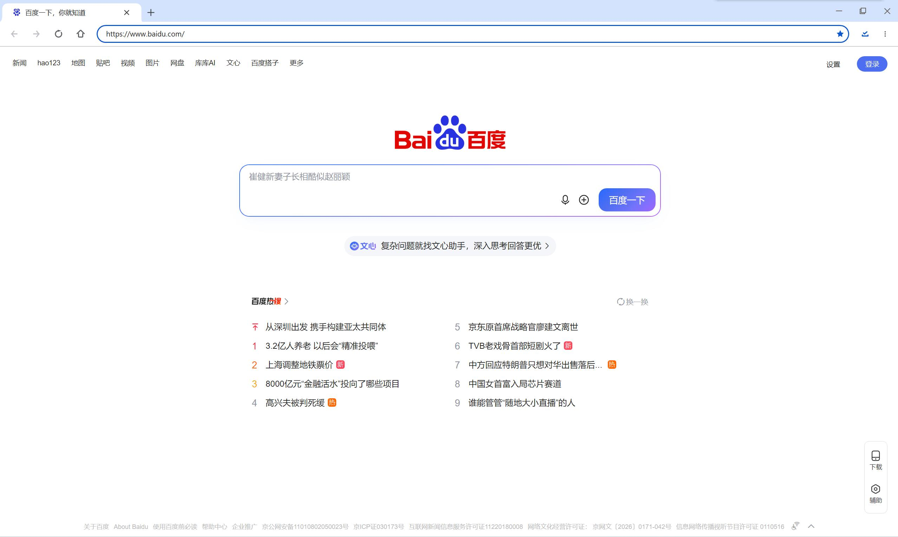
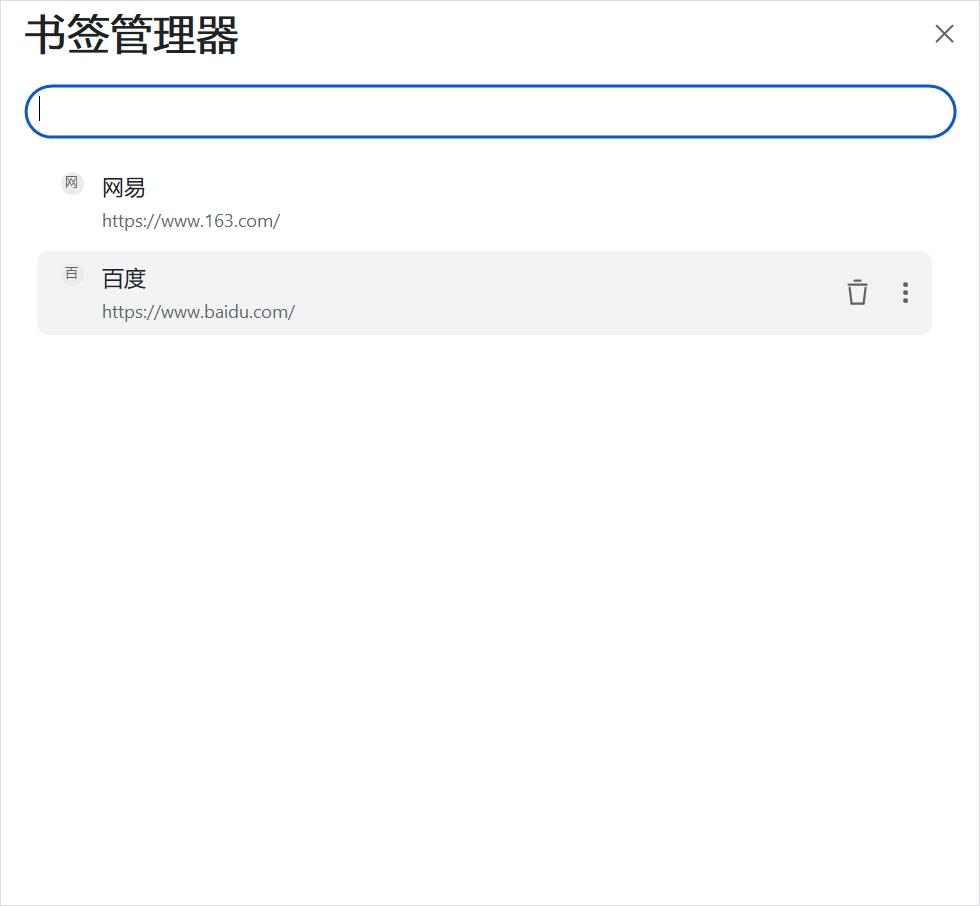
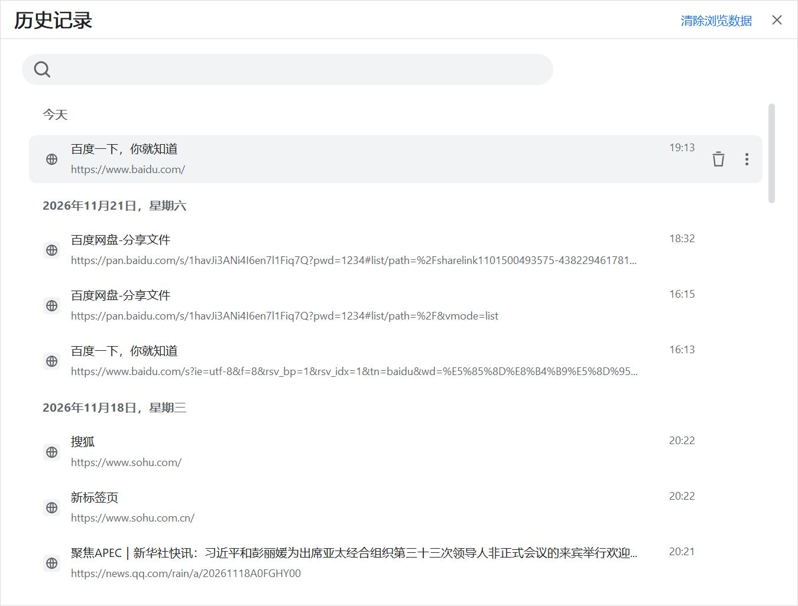
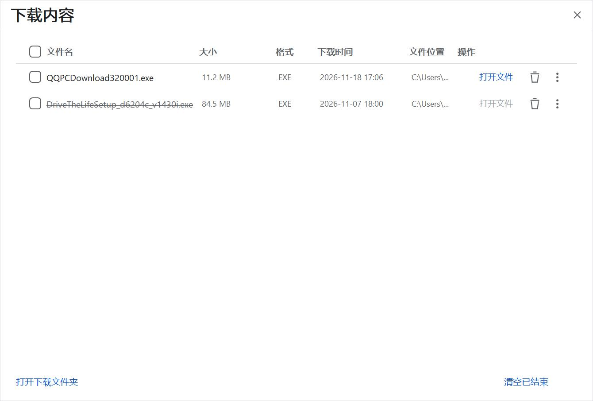
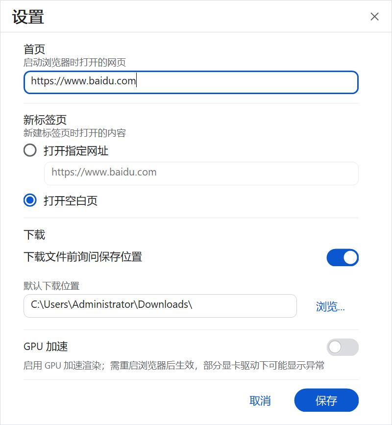
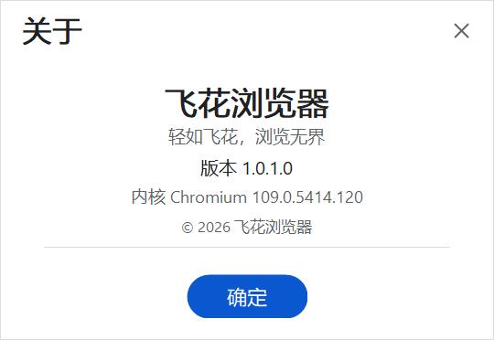

<p align="center"></p>

# 飞花浏览器（FHBrowser）

**轻如飞花，浏览无界**

一款用 **Delphi 11 VCL + CEF（Chromium Embedded Framework）** 实现的 Chrome 风格多标签浏览器。
界面完全自绘（标签条、地址栏、按钮、菜单、设置页、书签/历史/下载列表），不依赖第三方皮肤库。

> A Chrome-style multi-tab browser built with Delphi 11 VCL and CEF, with fully owner-drawn UI.

## 功能

- 多标签：新建/关闭/中键关闭/拖拽排序/Pin 固定/溢出滚动/右键菜单（带图标）
- 地址栏：URL 输入回车导航、自动补 `https://`、内嵌星标收藏
- 导航：后退/前进/刷新（加载中动画）/主页
- 书签栏 + 书签管理器：新增/编辑/删除/行内菜单
- 历史记录：搜索、按日期分组、单条删除、Ctrl+H
- 下载：工具栏双图标、下载气泡、下载记录窗口
- 查找栏、设置页、关于页（显示 CEF 内核版本与程序版本）
- 用户数据统一存放于 exe 同级 `UserData\`（settings.ini、History.db）

## 截图

| 主界面 | 书签管理器 |
| :---: | :---: |
|  |  |

| 历史记录 | 下载内容 |
| :---: | :---: |
|  |  |

| 设置 | 清除浏览数据 |
| :---: | :---: |
|  |  |

<p align="center"></p>

## 技术栈

| 项目 | 说明 |
| --- | --- |
| IDE / 编译器 | Delphi 11 Alexandria（Studio 22.0） |
| UI 框架 | VCL（全部自绘，GDI + GDI+ 抗锯齿） |
| 浏览器内核 | CEF 109 / Chromium 109（Win32） |
| CEF Delphi 绑定 | CEF4Win7（CEF4Delphi 的 Win7 兼容分支，[源码 109.0.5414.120](https://github.com/salvadordf/CEF4Delphi/tree/109.0.5414.120)，不随仓库分发） |
| 数据存储 | SQLite（`sqlite3.dll`，随运行时提供） |
| 崩溃报告 | madExcept（**可选**，商业组件，默认关闭） |
| 目标系统 | Windows 7 SP1 ~ Windows 11，仅 Win32 |

## 目录结构

```
src/                       浏览器主工程（FHBrowser.dpr）
  components/              可复用组件包 FHChromeTabsPkg
    uFHChromeTabs.pas      标签条 TFHChromeTabs
    uFHChromePageHost.pas  页面容器 TFHChromePageHost / TFHChromePage
    uFHBrowserControls.pas 导航按钮/地址栏/窗口按钮
    uFHChromeMenu.pas      Chrome 风格自绘菜单
    uFHChromeTabsReg.pas   设计期注册单元
  uFHChromeWidgets.pas     自绘小控件（开关/单选/复选/输入框/分段/按钮）
  uBrowserMain.pas         主窗体与浏览器交互
  ...
assets/icon/               应用图标源（PNG / ICO，scripts/make_icon.ps1 可重生）
assets/screenshots/        README 截图（main / bookmarks / history / downloads 等）
scripts/                   本地辅助脚本（make_icon.ps1）
bin/                       运行目录（CEF 运行时 + exe，不入库）
```

## 构建

### 1. 准备环境

1. 安装 Delphi 11（默认路径 `C:\Program Files (x86)\Embarcadero\Studio\22.0`）。
   如果装在别处，设置环境变量 `BDS` 指向安装根目录。
2. 自备 **CEF4Win7 源码**（其 `source\` 下为 `uCEF*.pas`），获取地址：
   <https://github.com/salvadordf/CEF4Delphi/tree/109.0.5414.120>。放置方式任选其一：
   - 设置环境变量 `CEF4WIN7` 指向源码根目录（例如 `C:\CEF4Delphi\109.0.5414.120`）；
   - 或把源码放到项目下 `third_party\CEF4Win7\`（`build_browser.bat` 会自动发现，
     该目录已被 `.gitignore` 忽略）。

   工程搜索路径使用 `$(CEF4WIN7)\source`；脚本探测成功后会把路径传给 msbuild，
   直接打开 IDE 编译时仍需系统环境变量。

3. 下载 **CEF 109.0.5414.176 Win32 运行时**并解压到 `bin\`，至少包含：
   `libcef.dll`、`chrome_elf.dll`、`icudtl.dat`、`v8_context_snapshot.bin`、
   `snapshot_blob.bin`、`*.pak`（含 `locales\` 目录下的 pak）、`libEGL.dll`、
   `libGLESv2.dll`、`vk_swiftshader*.dll`、`vulkan-1.dll`、`d3dcompiler_47.dll`，
   以及历史记录所需的 `sqlite3.dll`。
   运行时压缩包计划随 Release 附件提供；也可自行获取对应版本的 CEF 构建产物。
4. （可选）崩溃报告：安装 madExcept（BDS22），在 `src\FHBrowser.dproj` 的
   `Base_Win32` 配置里添加编译定义 `MADEXCEPT`，并把 madExcept 的
   `win32` 目录加入搜索路径。**默认不启用**，未安装 madExcept 也能正常编译。

### 2. 编译

```bat
build_browser.bat
```

脚本等价于：

```bat
call "%BDS%\bin\rsvars.bat"
msbuild src\FHBrowser.dproj /t:Build /p:Config=Base /p:Platform=Win32 /v:m
```

输出：`bin\FHBrowser.exe`（清单设置为 `requireAdministrator`，用于 CEF 沙箱与
bin 目录写入，启动时会请求管理员权限）。

### 3. 运行

双击 `bin\FHBrowser.exe`（或从命令行运行）。首次启动会在 `bin\UserData\`
生成配置与数据库；删除该目录即可恢复出厂状态。

## 组件包

`src\components\FHChromeTabsPkg.dproj` 是 runtime + designtime 合一的组件包：

- 控件页：`FHChromeTabs`
- 注册控件：`TFHChromeTabs`、`TFHChromePageHost`、`TFHNavButton`、
  `TFHAddressBar`、`TFHCaptionButton`
- 内部类（不注册）：`TFHChromePage`、`TFHStarGlyph`、`TFHMenu`/`TFHMenuWindow`

安装：在 IDE 中打开包工程 → 右键 Install。也可不安装，直接 `uses` 组件单元。


## 已知限制

- **Chromium 109 已停止安全更新**（2023 年起 EOL），本项目定位为技术演示与学习用途，
  不建议作为日常主力浏览器处理敏感数据。升级内核需同步更新 CEF4Win7 绑定与工程路径。
- 仅支持 Win32；64 位未验证。
- 程序以管理员权限运行（`requireAdministrator`）。
- 源码含中文注释，`.pas` 文件必须保留 **UTF-8 BOM**，否则 Delphi 编译报错。
- 不包含 CEF 二进制；克隆后必须按上文放入 `bin\`。
- 单元测试与组件 Demo 工程仅本地保留，不入库（DUnitX 用例当前 29/29 通过）；
  构建入口为 `build_browser.bat`。

## 贡献

欢迎 Issue / PR。提交前请：

1. 保持 `.pas` 的 UTF-8 BOM 与 CRLF 行尾（`.gitattributes` 已配置）；
2. 中文注释、中文界面文案；
3. 跑通 `build_browser.bat`，确认主程序可正常编译运行。

## 许可证

本项目采用 [MIT License](LICENSE)，但 `src/cef.inc` 例外：它来自 CEF4Delphi
（DCEF3），按 LGPL 或 MPL 1.1 授权，不适用 MIT。其余第三方组件许可见
[THIRD-PARTY-NOTICES.md](THIRD-PARTY-NOTICES.md)。
